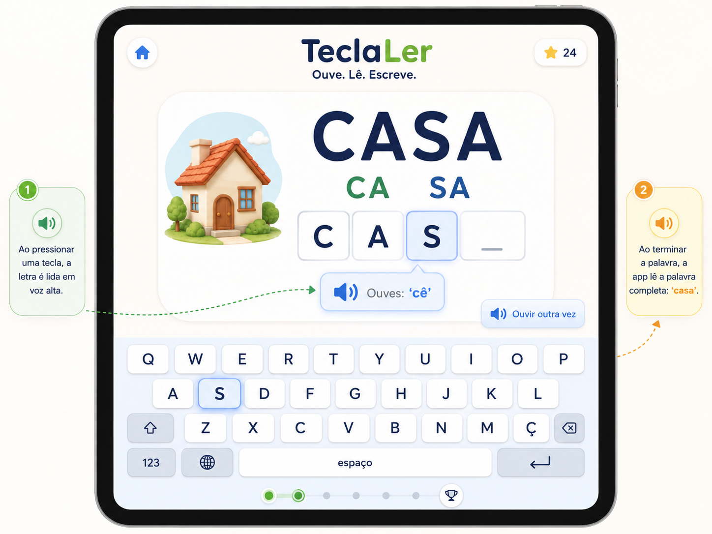

# TeclaLer Governance Package

**Project:** TeclaLer  
**Purpose:** Codex-ready governance, architecture, workflows, agents, skills, and implementation steps for a Portuguese reading-and-typing app for children.  
**Date:** 2026-07-01

## What this package is

This package is designed to be dropped into a new repository before implementation begins. It gives Codex and human contributors the project rules, architecture, product scope, child-safety requirements, curriculum rules, audio rules, and phased build plan.

## Core product loop

```text
Child sees text → child presses key → app reads key/sound in Portuguese → syllable completes → word completes → app reads full word
```

## Recommended build path

```text
Web app MVP → PWA/offline → Android wrapper → iOS wrapper
```

## Start here

1. Read `START_HERE_FOR_CODEX.md`.
2. Read `AGENTS.md`.
3. Read `docs/ARCHITECTURE.md`.
4. Read `backlog/CODEX_TASKS.md`.
5. Use the concept image at `assets/design/teclaler_app_interface_for_learning.png`.

## Included

```text
AGENTS.md
START_HERE_FOR_CODEX.md
TECLALER_FULL_GOVERNANCE_PACKAGE.md
docs/
agents/
skills/
workflows/
backlog/
templates/
data/
design/
assets/design/
references/
```

## Design concept



## Non-negotiables

- No ads.
- No social features.
- No public leaderboards.
- No external links in child mode.
- No unnecessary child data.
- No voice recording of children.
- No production reliance on uncontrolled device text-to-speech.
- Portuguese language content must be variant-aware and reviewed.
- The child must always see the target text.

## Initial web app foundation

The first working app scaffold is a Vite + React + TypeScript application for the `pt-PT` TeclaLer learning loop. It loads a content-driven five-word starter lesson (`CASA`, `MALA`, `PATO`, `SAPO`, `BOLA`), supports physical keyboard input and the custom Portuguese on-screen keyboard, routes audio through a replaceable manifest-backed audio service, and stores only local progress state in the browser.

Starter lesson content lives in `src/curriculum/starterLesson.ts`. The React app consumes generated `CurriculumItem` objects from `src/curriculum/ptPTPack.ts`, so word text, syllables, expected keys, and audio event IDs stay out of UI components.

Real reviewed audio files are not included yet. In development, missing files fall back to browser speech synthesis through the audio adapter. Production release must replace that fallback with approved manifest audio by updating `src/audio/manifest.ts` paths and review statuses.

### Run locally

```bash
npm install
npm run dev
```

### Test

```bash
npm test
```

The current tests cover the pure lesson engine, Portuguese keyboard normalization, on-screen keyboard emission, curriculum/audio validation, structured starter lesson validation, every starter word through physical-keyboard-style input, and full lesson completion through both physical and on-screen keyboard input.

### Validate Content

```bash
npm run validate:content
```

This checks the local starter lesson, generated curriculum pack, and placeholder audio manifest outside the test suite. It fails for missing audio IDs, duplicate lesson/word/audio IDs, target/display text mismatches, malformed starter lesson fields, syllable or grapheme mismatches, and unsupported `pt-PT` keyboard characters.

To simulate release-mode audio checks without publishing anything:

```bash
npm run validate:content -- --release
```

That release-mode check is expected to fail while placeholder audio remains marked `needs_review`.

### Build

```bash
npm run build
```

The app includes a web app manifest and a simple production service worker registration path. Full Workbox/offline hardening remains a later PWA task.

### Test on an iPad

1. Start the dev server on the computer:

```bash
npm run dev
```

2. Make sure the iPad is on the same local network.
3. Open the Network URL shown by Vite on the iPad, for example `http://192.168.x.x:5173/`.
4. Tap once anywhere on the lesson screen if the browser has not focused the page yet.
5. Type the visible word using the iPad hardware keyboard or tap the on-screen TeclaLer keyboard.
6. Use `Próxima palavra` to move through all five starter words: `CASA`, `MALA`, `PATO`, `SAPO`, `BOLA`.
7. After completing a word, pressing `Enter` on a hardware keyboard advances to the next word.

The iPad test should confirm that the target word stays visible, the current key is highlighted, wrong keys do not advance, `Ouvir outra vez` remains available, and no account, analytics, ads, external links, cloud sync, or microphone permission appears.
