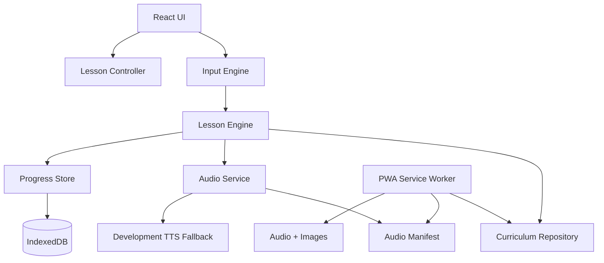

# Architecture

## Recommended stack

```text
Vite + React + TypeScript
Vitest + Testing Library + Playwright
PWA/Workbox
IndexedDB via Dexie or localForage
```

## Layered architecture



## Domain model

```ts
interface CurriculumItem {
  id: string;
  type: 'letter' | 'syllable' | 'word' | 'sentence';
  locale: 'pt-PT' | 'pt-BR';
  text: string;
  displayText: string;
  syllables?: string[];
  graphemes: string[];
  targetSequence: string[];
  audio: {
    letters?: string[];
    syllables?: string[];
    word?: string;
    sentence?: string;
  };
  imageId?: string;
  difficulty: number;
  status: 'draft' | 'pedagogy_review' | 'pronunciation_review' | 'ready_for_dev' | 'ready_for_release' | 'released' | 'retired';
}
```

## Lesson engine

Pure TypeScript. No React dependency. It accepts canonical input and emits semantic events.

```ts
type LessonEvent =
  | { type: 'KEY_ACCEPTED'; char: string; audioId?: string }
  | { type: 'KEY_REJECTED'; expected: string; actual: string }
  | { type: 'SYLLABLE_COMPLETED'; syllable: string; audioId?: string }
  | { type: 'WORD_COMPLETED'; itemId: string; audioId?: string };
```

## Audio service

```ts
interface AudioService {
  play(audioId: string, options?: { interrupt?: boolean }): Promise<void>;
  preload(audioIds: string[]): Promise<void>;
  replayLast(): Promise<void>;
}
```

Production uses audio files. Development may use Web Speech API fallback.

## PWA/offline

Cache:

- app shell,
- current curriculum pack,
- audio manifest,
- audio files,
- image files.

## Backend

No backend in MVP. Backend requires ADR, privacy review, security review, and account/consent model.
