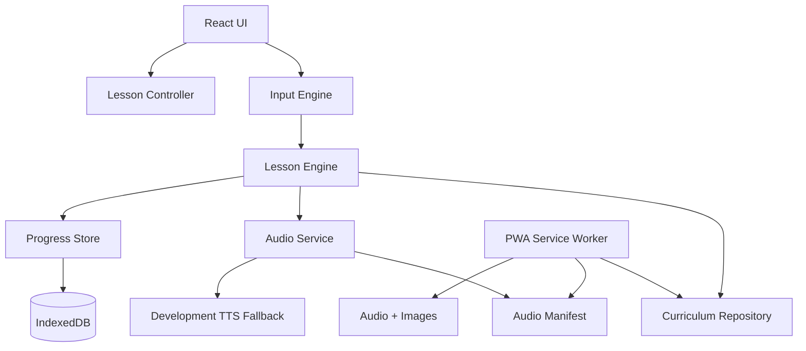

# Architecture

## Recommended stack

```text
Vite + React + TypeScript
Vitest + Testing Library + Playwright
PWA/Workbox
IndexedDB via Dexie or localForage
```

## Layered architecture



## Domain model

```ts
interface CurriculumItem {
  id: string;
  type: "letter" | "syllable" | "word" | "sentence";
  locale: "pt-PT" | "pt-BR" | "en-GB";
  text: string;
  displayText: string;
  syllables?: string[];
  graphemes: string[];
  targetSequence: string[];
  audio: {
    letters?: string[];
    syllables?: string[];
    word?: string;
    sentence?: string;
  };
  imageId?: string;
  imageAsset?: string;
  imageAlt?: string;
  difficulty: number;
  status:
    | "draft"
    | "pedagogy_review"
    | "pronunciation_review"
    | "ready_for_dev"
    | "ready_for_release"
    | "released"
    | "retired";
}
```

## Lesson engine

Pure TypeScript. No React dependency. It accepts canonical input and emits semantic events.

```ts
type LessonEvent =
  | { type: "KEY_ACCEPTED"; char: string; audioId?: string }
  | { type: "KEY_REJECTED"; expected: string; actual: string }
  | { type: "SYLLABLE_COMPLETED"; syllable: string; audioId?: string }
  | { type: "WORD_COMPLETED"; itemId: string; audioId?: string };
```

## Audio service

```ts
interface AudioService {
  play(
    audioId: string,
    options?: { interrupt?: boolean; volume?: number },
  ): Promise<void>;
  preload(audioIds: string[]): Promise<void>;
  replayLast(): Promise<void>;
  stop?(): void;
  speak(
    message: { text: string; locale?: LessonLocale },
    options?: { interrupt?: boolean; volume?: number },
  ): Promise<void>;
}
```

Production uses audio files. Development may use Web Speech API fallback.

The typing lesson queues semantic audio events across rapid accepted input so
each accepted letter is heard once, followed by the completed word once.
Syllable events remain available to phonics activities and manual replay but
are not inserted into that typing sequence. Correction, replay, or navigation
may cancel the queue. Completion navigation stays disabled until the final
queued word recording finishes.

## Lesson locales and Portuguese variants

The MVP exposes `pt-PT`, `pt-BR`, and `en-GB` as explicit local lesson settings. Each locale must use a matching curriculum pack and audio manifest; the UI must not relabel one locale while playing another locale's audio IDs.

Portuguese variants remain explicit pedagogy variants. Released Portuguese lessons must not mix `pt-PT` and `pt-BR` pronunciation in one lesson.

## PWA/offline

Cache:

- app shell,
- current curriculum pack,
- audio manifest,
- audio files,
- image files.

## Backend

No backend in MVP. Backend requires ADR, privacy review, security review, and account/consent model.
