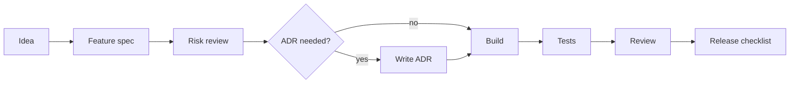
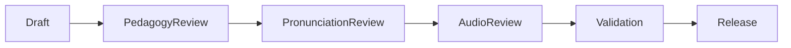

# Workflows

## Feature delivery



## Content release



## Audio release

```text
script list → record/generate source → export → add manifest → review → validate → device test → release
```

## Privacy review

```text
change proposed → data map → risk level → DPIA-lite if needed → mitigation → approval/hold
```

## Incident response

```text
stop release → classify → fix/remove → test → legal/privacy review if needed → release patch → regression test
```
